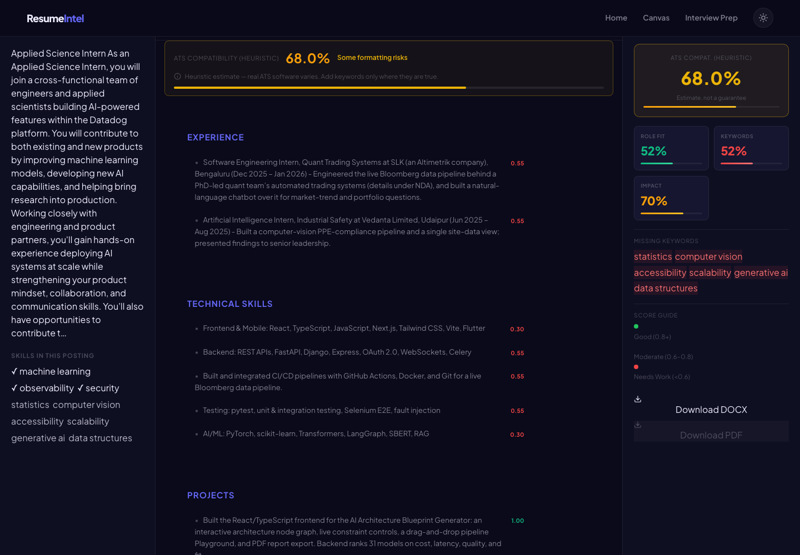
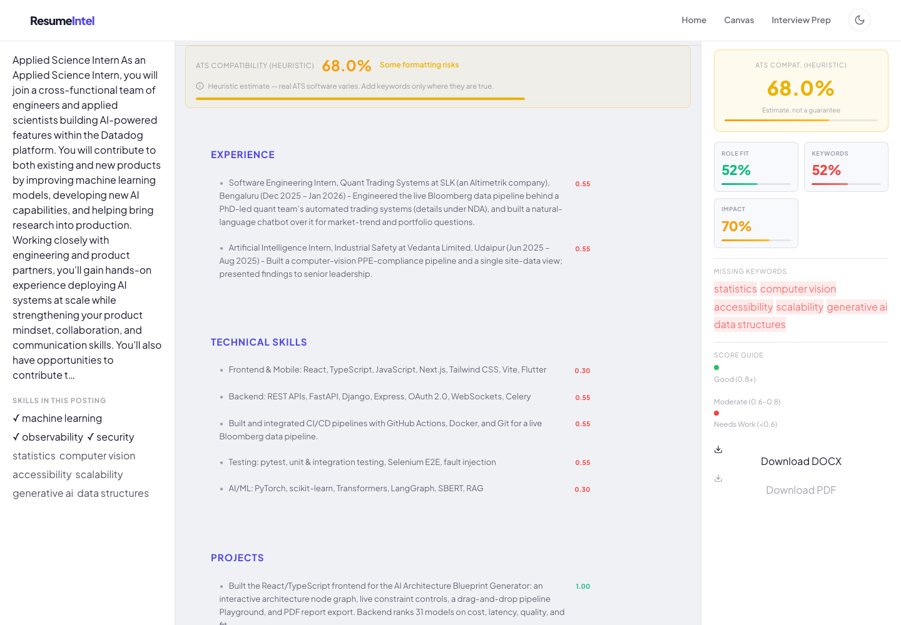
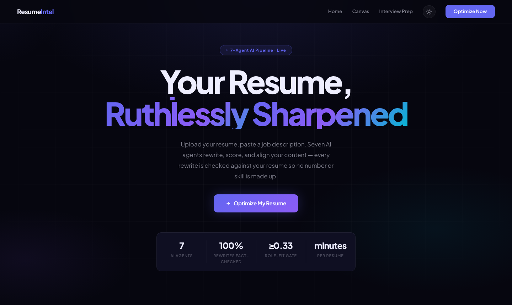
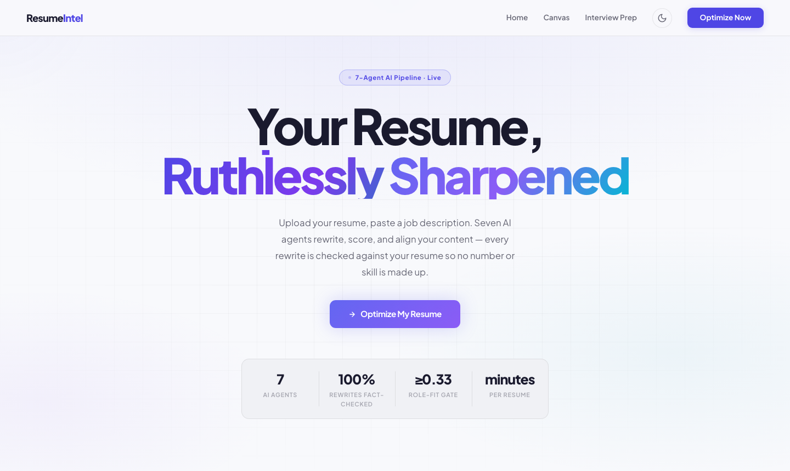
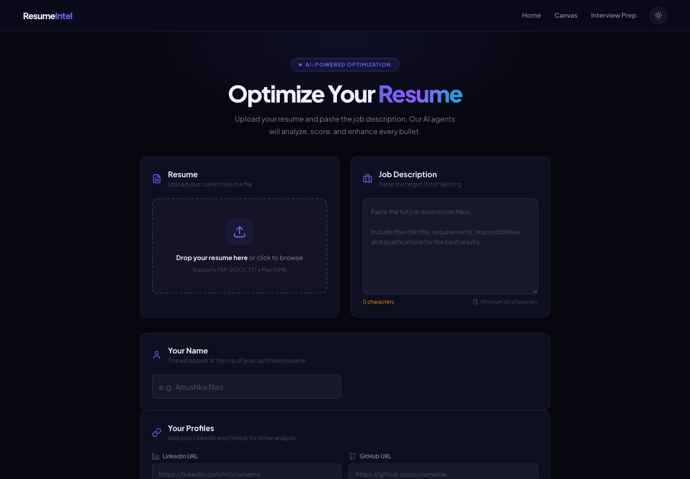
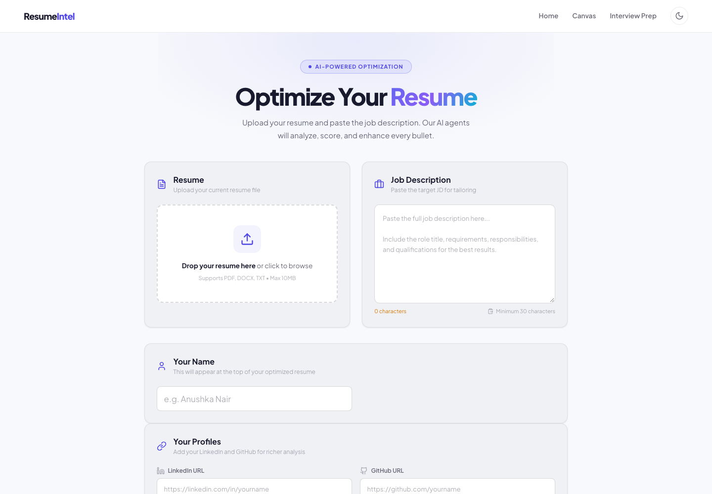

<div align="center">

<h1>ResumeIntel</h1>
<p><strong>A multi-agent resume tailoring tool that is only allowed to use what your resume already says.</strong></p>

<p>
  
  
  
  
  
  
  
  
</p>
<p>
  <a href="https://github.com/anushkaanair/ResumeIntel"></a>
  <a href="https://linkedin.com/in/anushka-nair"></a>
</p>

<p><a href="https://anushkaanair.github.io/ResumeIntel/"><strong>▶ Live demo</strong></a> — the real UI replaying one recorded run (no backend, nothing to install)</p>

<p>
  <a href="#what-it-is">Overview</a> ·
  <a href="#screenshots">Screenshots</a> ·
  <a href="#how-it-works">How it works</a> ·
  <a href="#what-the-numbers-mean">What the numbers mean</a> ·
  <a href="#measured-results">Results</a> ·
  <a href="#setup">Setup</a> ·
  <a href="#running-it-privately-reachable-from-anywhere-free">Run privately</a> ·
  <a href="#api-reference">API</a> ·
  <a href="#patent-information">Patent</a>
</p>
</div>

## What it is

You give ResumeIntel your resume and a job description. Seven cooperating agents rewrite, score and tailor the resume for that role, and show you every change before anything is exported.

The design rule that shapes everything else: **the tool may reorder, emphasise and reword what your resume already shows, but it may not add a number or a skill that your resume does not contain.** Most resume tools do the opposite — they are rewarded for "metrics" and "keywords", so they invent both. Here, every rewrite is checked against your original text, and a rewrite that introduces a new figure or a JD skill you never listed is rejected and retried, not shown.

It is built to be used on real applications: it tells you when a role is a poor fit instead of forcing a rewrite, keeps bullets it cannot honestly improve exactly as you wrote them, and labels its ATS number for what it is — a heuristic.

## Screenshots

The main canvas — the tailored resume with per-bullet scores, the heuristic ATS banner, role-fit, keyword and impact metrics, and the keywords the posting asks for that your resume does not show:

| Dark | Light |
|---|---|
|  |  |

Landing page and the upload form:

| Dark | Light |
|---|---|
|  |  |
|  |  |

> Screenshots are of a real run: the author's own resume against a real Datadog posting, using a local 3B model (`qwen2.5:3b`). A hosted model writes noticeably better bullets; the grounding and gating behave the same either way.

## How it works

```
 resume + job description
          │
          ▼
 1 Ingestion ──► 2 Generation ──► 3 Quality ──► 4 Weak Detection ──► 5 Tailoring
   parse,           RAG-grounded     per-bullet       gaps against        alignment gate,
   sections,        rewrite          gate, 3-stage    the JD              then grounded
   index in FAISS                    retry                                tailoring
                                                                              │
                                              ┌───────────────────────────────┤  asyncio.gather
                                              ▼                               ▼
                                       6 Interview                      7 ATS compatibility
                                       adaptive Q&A                     4 platform profiles (heuristic)
          │
          ▼
 Canvas: accept / reject / dispute each bullet  ──►  export only what you accepted
```

Progress streams to the browser over a WebSocket while the pipeline runs in the background. If a stage fails, the pipeline keeps going with the previous version and reports a warning instead of discarding the run; only an unparseable resume stops it.

| # | Agent | What it does | Real mechanism |
|---|---|---|---|
| 1 | **Ingestion** | Parses the resume into sections | Header detection (handles "Technical Skills", "Internships", inline `Skills:` …); quality is the share of expected content found. Indexes segments in FAISS, de-duplicated by segment id. |
| 2 | **Generation** | Rewrites bullets from retrieved facts | Top-k SBERT retrieval before every LLM call. Output is checked against the original resume (see *Grounding*); a failing rewrite is retried with the offending items named. |
| 3 | **Quality** | Scores and improves each bullet | Score = strong verb (0.4) + specificity (0.3) + concision (0.2), minus weak phrases. Specificity is a number *that exists in your resume* or ≥ 2 concrete technologies from it. Weak bullets get up to three rewrites with escalating constraints; a bullet that cannot be improved honestly is kept as written and flagged `unresolvable`. |
| 4 | **Weak Detection** | Finds gaps against the JD | Short or vague bullets, weak verbs, missing metrics, missing sections, and JD skills your resume does not show, ranked by how much the posting emphasises them (requirements section outweighs "nice to have"). |
| 5 | **Tailoring** | Fits the resume to the role | **Alignment gate** first (below). Then reorder / emphasise / reword under the same grounding check, and verify that the rewrite did not drop most of the resume. |
| 6 | **Interview** | Adaptive practice questions | 4-dimension performance vector (technical depth, behavioural clarity, communication, domain knowledge); difficulty tier recomputed every 3 answers. A reply the model fails to grade is an error, not a default 0.6. |
| 7 | **ATS** | Parse-risk check per platform | Workday, Greenhouse, Lever, Taleo profiles: section recognisability, date format per platform, header/special characters, bullet length, and presence of the posting's recognisable skills. **A heuristic, not a real ATS.** |

### Grounding — the central guarantee

`src/scoring/grounding.py` compares any generated text with your original resume and flags:

- **novel numbers** — percentages, counts and multipliers that appear in the output but nowhere in the source (years, list numerals and bare single digits are ignored);
- **injected skills** — technologies the job description names, that the output claims, and that your resume never mentioned.

It runs inside the Generation, Quality and Tailoring agents, on section re-optimise / enhance, on dispute rewrites, and once more over the final document (reported as a warning in the result). It is a mechanical check, not a promise that a model can never mislead — wording that overstates a real fact (e.g. "led" for "contributed to") is not detectable this way, so read what you export.

### Alignment gate

Before tailoring, the full resume and the JD are embedded (SBERT `all-MiniLM-L6-v2`) and compared by cosine similarity. Below `ALIGNMENT_THRESHOLD` (default **0.33**) tailoring stops and you get a diagnosis instead of a rewrite: the weakest *editable* sections (experience, projects, skills, summary — not education or contact details) and the skills the posting asks for that your resume does not show.

The default was calibrated, not guessed. On 12 real postings the author would apply to, similarity ranged 0.38–0.56; on 8 unrelated postings (sales, nursing, etc.) it ranged 0.22–0.38. A threshold of 0.33 blocks 6 of 8 unrelated roles and 0 of 12 real ones. (An earlier default of 0.60 sat above every real posting and would have aborted all of them.) The embedding model reads roughly the first 256 tokens of each text, so this gate separates *related from unrelated* roles — it is not a fine-grained ranking of two similar roles. If you change the embedding model, re-calibrate.

## What the numbers mean

| Number in the UI | What it is | What it is not |
|---|---|---|
| **Role fit** | Cosine similarity between your tailored resume and the JD (`~0.33` = barely related, `~0.5` = clearly related). Green ≥ 0.45, amber ≥ 0.33. | A probability of getting an interview. |
| **ATS compatibility (heuristic)** | Average over four platform profiles of section recognisability, date parsing and presence of the posting's recognisable skills. | The output of Workday, Greenhouse, Lever or Taleo. No tool outside those vendors can give you that. |
| **Keywords** | Weighted share of the posting's recognisable skills (a curated vocabulary with aliases — "k8s" = Kubernetes) that your resume shows. | Raw word overlap. "Go", "R", "Spring 2027" and "express interest" are handled so they do not count as skills. |
| **Impact** | Action-verb strength and quantification across bullets (it rewards digits, so it can be raised only by having real numbers). | A measure of how impressive your work is. |
| Per-bullet score | The Quality-agent score described above. | A score you can raise by adding a number — an invented number earns nothing. |

## Measured results

These numbers come from running the real pipeline on the author's own one-page resume against real public postings, with a **local 3B model** (`qwen2.5:3b`, the largest that fits the author's laptop). They are a floor for what a hosted model gives you, not a showcase.

**Before vs after the grounding/gating work** (same resume, same Datadog Applied Science posting):

| | Original pipeline | Now |
|---|---|---|
| Ingestion | Rejected the resume ("quality 0.50 < 0.6") — it only recognised four literal headings and the resume says "Technical Skills" | 7 sections found, quality 1.0 |
| Alignment gate | Fixed at 0.60; the resume scored 0.51, so the run **aborted** (and so would have all 12 real postings) | 0.33, calibrated; run completes |
| Run outcome | Crashed after 256 s | Completes in ~8 min on a 3B model |
| Invented numbers / JD skills in the output | Prompts *required* "a number in every bullet" and "every JD keyword verbatim" | **0 / 0** — rewrites are checked against the original and rejected otherwise |
| Bullets that could not be improved honestly | Not reported (forced to pass by adding numbers) | Kept as written and flagged (5 in this run) |
| Test suite | 25 passed, 13 failed | **64 passed**, 0 failed |

**Alignment gate calibration** (embedding cosine, resume ↔ posting):

| Postings | n | Similarity range |
|---|---|---|
| Real roles the author would apply to (Cohere, Perplexity, Datadog, Snowflake, Palantir, Scale, Rubrik, Sierra …) | 12 | 0.38 – 0.56 (mean 0.47) |
| Unrelated roles | 8 | 0.22 – 0.38 |

At 0.33 the gate lets all 12 real postings through and blocks 6 of 8 unrelated ones.

**What a 3B model still gets wrong.** On a second run against the same posting, the Tailoring agent's three attempts were each rejected for adding "generative ai" / "computer vision" (skills the posting names and the resume lacks) and, once, a placeholder phone number. The pipeline did what it should: it kept the previous version, showed a warning in the UI, and did not present invented claims as yours — but it means a small local model often cannot complete the tailoring step honestly. Use a hosted model for the tailoring pass, or accept the Quality-agent output, which is still produced and still grounded.

A full 12-posting sweep is scripted but takes hours on a laptop 3B model, so it is not summarised here; run it yourself with the commands below and it writes `summary.md` with per-posting status, gate decisions and fabrication flags.

Reproduce it (needs [Ollama](https://ollama.com) with a ≤ 3B model, or an OpenAI key; resume text stays local with Ollama):

```bash
uv run python -m evals.fetch_jds        # 12 real postings via public Ashby/Lever/Greenhouse APIs → data/eval/ (git-ignored)
LLM_PROVIDER=ollama OLLAMA_MODEL=qwen2.5:3b \
  uv run python -m evals.run_eval --resume path/to/resume.pdf --truth path/to/source_of_truth.md --out data/eval/run-1
```

`--truth` is your canonical resume; the eval flags any number or JD skill in the output that appears in neither the resume you uploaded nor the truth file. `data/` is git-ignored because outputs contain personal details.

## Novel inventive steps

Five mechanisms form the patent filing. How each is implemented today:

1. **Live profile sync with a JD-filtered approval queue.** GitHub / LinkedIn deltas are embedded and kept only if cosine similarity to the JD is ≥ 0.5; staleness = `min(days_since_sync / 30, 1)`. Approved items re-enter the generation + quality path before reaching the canvas. *LinkedIn needs your own OAuth app; GitHub works with a token or OAuth.*
2. **Semantic alignment gate with abort and section diagnosis.** As above — tailoring stops and ranks the weakest editable sections instead of forcing a rewrite.
3. **Three-stage escalating constraint retry.** Each stage tightens the instruction (stronger verb → format `[verb]+[what]+[result if stated]` → one bullet under 20 words). Rewrites that fail grounding are rejected at any stage. Bullets that fail all three are flagged `unresolvable` and shown unchanged.
4. **Provenance-linked dispute loop.** Every scored output carries a `Provenance` record (agent, retrieved chunk ids, rationale, confidence). The *Why* panel shows it, and `POST /canvas/dispute/{bullet_id}` re-evaluates a bullet with your objection as context. An unparseable model reply returns an error rather than a default score, and a revised bullet that adds unsupported claims is discarded.
5. **Decision-state-conditional export.** `POST /canvas/export` assembles DOCX/PDF only from bullets you marked accepted or edited, in original order.

## Tech stack

| Layer | Technology |
|---|---|
| Frontend | React 18 · TypeScript · Vite · Tailwind · Zustand · pdf.js (client-side PDF text extraction) |
| Backend | FastAPI · Python 3.11 · asyncio background jobs |
| Retrieval | `sentence-transformers` all-MiniLM-L6-v2 · FAISS (per-user index, metadata sidecar) |
| LLM | OpenAI or any OpenAI-compatible endpoint (`OPENAI_BASE_URL`), or local Ollama. No LangChain, no Groq-specific code. |
| State | Redis only — job results, pub/sub for WebSocket events, canvas versions, interview state. (There is no SQL database in use.) |
| Export | python-docx · reportlab |
| Packaging | uv · Docker / Docker Compose |

## Project structure

```
ResumeIntel/
├── src/
│   ├── agents/          ingestion · generation · quality · weak_detection · tailoring · interview · ats
│   ├── scoring/         grounding.py (fabrication check) · keywords.py (JD skill extraction) · alignment · impact · keyword_coverage
│   ├── rag/             embedder · vector_store (FAISS) · retriever
│   ├── api/             FastAPI app · security.py (API-key middleware) · routes/ · schemas/
│   ├── llm/             OpenAI / Ollama client
│   ├── db/              redis_store.py (SQLAlchemy models exist but are not used by the routes)
│   ├── pipeline.py      orchestrator with per-stage graceful degradation
│   └── main.py          ASGI entrypoint (src.main:app)
├── frontend/            React app (src/pages · components · stores · lib)
├── evals/               fetch_jds.py · run_eval.py — real-posting evaluation harness
├── tests/               pytest suite
├── docs/screenshots/
├── run_private.sh       one command: UI + API + tunnel
├── deploy/hf/           Hugging Face Space packaging (optional)
├── Dockerfile · docker-compose.yml · .env.example · start.sh
```

## Setup

**Prerequisites:** Python 3.11+, [uv](https://docs.astral.sh/uv/), Node 18+, Redis (or Docker), and either an OpenAI key or [Ollama](https://ollama.com).

```bash
git clone https://github.com/anushkaanair/ResumeIntel.git
cd ResumeIntel
cp .env.example .env            # then edit — see the table below

# Backend
uv sync --python 3.11 --extra dev
docker run -d --name resumeintel-redis -p 6379:6379 redis:7-alpine   # or: brew install redis && redis-server
uv run uvicorn src.main:app --port 8000

# Frontend (second terminal)
cd frontend && npm install && npm run dev      # http://localhost:5173
```

`./start.sh` does the same in one command (Redis, backend, frontend).

**Using a local model** — nothing leaves your machine:

```bash
ollama pull qwen2.5:3b
# .env:  LLM_PROVIDER=ollama   OLLAMA_MODEL=qwen2.5:3b
```

Larger local models (7B+) write better resumes but need the RAM; a hosted model is better still.

If your API is not on `localhost:8000`, tell the frontend: `echo "VITE_API_URL=http://localhost:8010/api/v1" > frontend/.env.local`.

### Environment variables

| Variable | Default | Meaning |
|---|---|---|
| `LLM_PROVIDER` | `openai` | `openai` or `ollama` |
| `OPENAI_API_KEY` / `OPENAI_MODEL` / `OPENAI_BASE_URL` | – / `gpt-4o` / – | Hosted model; set the base URL for OpenAI-compatible providers |
| `OLLAMA_BASE_URL` / `OLLAMA_MODEL` | `http://localhost:11434/v1` / `llama3` | Local model |
| `REDIS_URL` | `redis://localhost:6379/0` | Required |
| `REDIS_TTL_SECONDS` | `3600` | How long finished results are kept |
| `ALIGNMENT_THRESHOLD` | `0.33` | Role-fit gate (cosine) |
| `API_SECRET_KEY` | *(empty = open)* | Shared secret; set it for anything reachable from the internet |
| `CORS_ORIGINS` | `http://localhost:5173,http://localhost:3000` | Comma-separated browser origins |
| `FAISS_INDEX_DIR` | `./data/faiss_indices` | Per-user vector indices |
| `LINKEDIN_*`, `GITHUB_*` | – | Optional profile sync |

### Tests

```bash
uv run pytest -q          # agents, grounding, retrieval, API (Redis and the LLM are faked)
cd frontend && npm run build
```

## Running it privately, reachable from anywhere (free)

ResumeIntel is built for one person using their own resume. The simplest free setup keeps everything on your laptop and shares it through a Cloudflare quick tunnel — no hosting account, no card, and with Ollama your resume never leaves your machine.

```bash
brew install cloudflared                # one-time (also needs Docker, uv and Node)
ollama pull qwen2.5:3b                  # or set OPENAI_API_KEY + LLM_PROVIDER=openai in .env
./run_private.sh
```

The script builds the UI, starts Redis, serves the API **and** the built UI from one port, and opens a tunnel. It prints a `https://….trycloudflare.com` link you can open from your phone or another computer. The first visit asks for an access key; it was generated into `.env` (`grep API_SECRET_KEY .env`) and is remembered in that browser only. Ctrl+C stops everything.

- **Reachable only while the script runs**, and the link changes each time. That is the trade-off for free, no-account hosting.
- **The API is locked** behind the key (`X-API-Key`; WebSockets use `?key=`). The page shell loads without it so the key screen can render.
- **Results live in Redis** for `REDIS_TTL_SECONDS` (a week in private mode).

**Always-on hosting** is a different trade-off: the backend needs a long-running container with ~1 GB RAM and Redis, which free serverless tiers (Vercel functions) cannot provide. `docker compose up --build` runs backend + Redis on any Docker host, and `deploy/hf/` packages the backend as a Hugging Face Space (free CPU Docker Space, Redis inside the container, state lost on restart). Put the frontend on any static host with `VITE_API_URL=https://your-api-host/api/v1 npm run build`.

- **Cost / privacy:** a run makes dozens of LLM calls. With a hosted model your resume text goes to that provider; with Ollama it does not.

## API reference

Base path `/api/v1`. All routes need `X-API-Key` when `API_SECRET_KEY` is set.

| Method | Path | Purpose |
|---|---|---|
| GET | `/health` *(no prefix)* | Liveness, whether auth is required, whether an LLM is configured |
| POST | `/resume/upload` | Parse an uploaded PDF/DOCX/TXT |
| POST | `/jd/parse` · GET `/jd/{jd_id}` | Parse and fetch a job description |
| POST | `/optimize` | Start the pipeline in the background → `{job_id}` |
| GET | `/optimize/{job_id}/status` · `/optimize/{job_id}/result` | Poll; result includes `metrics`, `warnings`, `alignment_gate`, `grounding` |
| WS | `/ws/optimize/{job_id}` *(no prefix)* | Live agent events: `AGENT_START`, `AGENT_COMPLETE`, `ALIGNMENT_GATE_ABORT`, `AGENT_ERROR`, `PIPELINE_COMPLETE`, `PIPELINE_ERROR` |
| POST | `/alignment/score` | Role fit between a resume and a JD |
| GET | `/canvas/{resume_id}/state` | Canvas state |
| POST | `/canvas/bullet/{id}/score` · `/suggest` · `/accept` | Per-bullet scoring, suggestion, decision |
| POST | `/canvas/dispute/{bullet_id}` | Dispute a bullet's score/content |
| POST | `/canvas/section/{id}/reoptimize` · `/enhance` | Rewrite a section; response includes a `grounding` report |
| POST | `/canvas/ats/quick-score` | Re-score ATS compatibility after edits |
| POST | `/canvas/profile/{linkedin,github}/refresh` · `/canvas/profile/item/regenerate` | Profile sync |
| POST | `/canvas/{resume_id}/version/snapshot` · `/version/revert` | Version history |
| GET | `/canvas/{resume_id}/version/history` · `/version/{version_id}/diff` | History and diff |
| POST | `/canvas/export` | Decision-gated DOCX / PDF export |
| POST | `/export/docx` · `/export/pdf` | Plain export |
| POST | `/interview/{job_id}/generate` · GET `/interview/{job_id}` | Interview questions |
| POST | `/interview/question/{question_id}/answer` | Practice answer → 4-dimension feedback |
| GET | `/auth/{linkedin,github}/{login,callback,status}` | OAuth for profile sync |

Interactive docs at `/docs`.

## Known limits

- **No tool can tell you your real ATS score.** The ATS number is a parse-risk heuristic.
- **Model quality matters.** A 3B local model sometimes shortens bullets or drops detail (the grounding and structure checks catch invented facts and wholesale loss, not every paraphrase). A hosted model is meaningfully better.
- **The gate separates related from unrelated roles**, not two similar roles.
- **Single-user by design** — one shared key, results expire from Redis after `REDIS_TTL_SECONDS`.
- **LinkedIn sync** needs your own approved LinkedIn developer app.
- Recognised-skill extraction is a curated vocabulary (software / ML / data / cloud); postings outside tech fall back to plain keyword overlap.

## Patent information

| Field | Detail |
|---|---|
| Title | AI-Powered Multi-Agent Resume Optimization and Career Intelligence System |
| Filed under | The Patents Act, 1970 (39 of 1970) & The Patent Rules, 2003 |
| Applicants | Neel Agarwal · Anushka Nair · Dr. Menaka S. |
| Institution | SRM Institute of Science and Technology, Tamil Nadu, India |
| Claims | 13 (system, method and application claims) |
| Status | Pending |

## Author

**Anushka Nair** — B.Tech CSE (AI & ML), SRM Institute of Science and Technology

<div align="center">
<sub>Patent pending under Indian patent law · © 2025 Anushka Nair & Neel Agarwal · SRM Institute of Science and Technology</sub>
</div>
